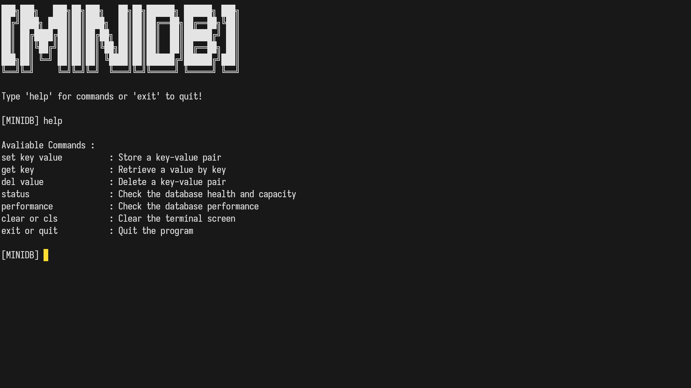

# MiniDB

An embedded, in-memory key-value store written from scratch in C11.


## About MiniDB

MiniDB is a small database that runs inside your program. It stores values under keys, finds them quickly, and keeps only the data that you use most often. It has no network layer and no external dependencies.

I built it to learn what happens inside systems like Redis and Memcached. Instead of reading about their design, I wrote a small engine from scratch and made the important choices myself.

## Journey

The project started as a hash map, a table that finds a key quickly. It cannot decide what to evict when it is full. I added a linked list that tracks recent use. Then I combined both inside a shard, a small independent piece of the database. Each shard owns a table, a usage list, and a pool of ready-to-use nodes. The database routes each key to one shard, so each table stays small.

Next came performance work. I changed the hash function and replaced an expensive division with a faster bitwise trick. I moved memory requests out of the normal read and write path. I also cleared old slots in bulk. The final step added the command-line interface and tests.

## Result

A simple idea became a working in-memory cache with clear behavior:

- Fast average lookup, insert, and delete.
- Immediate eviction of the least recently used key.
- Normal reads and writes do not request new memory.
- Sharded storage that keeps each table small.
- A small command-line interface for manual testing.

The design is a set of tradeoffs. Fixed-size keys and values avoid memory setup but limit input length. A fixed pool of nodes keeps memory use predictable but caps capacity. The engine is single-threaded, so it has no lock overhead but cannot serve concurrent writers.

## Benchmark and Limitations

Measured on my machine with clang and `-O3 -ffast-math -march=native -flto`. The `performance` command uses 4 shards with 4096 keys per shard.

| Phase | Operations | Throughput |
|---|---:|---:|
| Insert | 50,000,000 | ~4.75 M ops/s |
| Query | 50,000,000 | ~12.33 M ops/s |
| Mixed | 20,000,000 | ~9.01 M ops/s |

The table reports throughput in operations per second. The query test mostly asks for keys that are no longer there. The test database holds only 16,384 keys, so the inserts evict almost every key before the query phase.

**Limitations:**

- Single-threaded. The engine has no locks.
- Fixed capacity per shard.
- Keys stop at 31 characters and values at 63 characters.
- No persistence, expiry, transactions, or network support.
- Built with `-march=native`, so the binary depends on the build machine.

## Project Structure

```text
include/                Public headers for each module.
src/                    Implementation files.
test/                   Standalone unit and stress tests.
public/minidb.png       Project banner.
docs/ARCHITECTURE.md    Detailed architecture reference.
Makefile                Build and debug targets.
LICENSE                 MIT license.
```

## Project Setup

**Requirements:** `clang` (default) or `gcc`, and `make`.

```bash
git clone https://github.com/nikhil-thorat/minidb.git
cd minidb

# Build for performance.
make build

# Build with AddressSanitizer and no optimization.
make debug

# Run the existing build.
make run
```

`make build` creates `build/minidb`. `make debug` creates `build/minidb_debug`. To use gcc, run `make build CC=gcc`.

Basic commands inside the CLI:

| Command | Action |
|---|---|
| `set <key> <value>` | Store a value. |
| `get <key>` | Read a value. |
| `del <key>` | Delete a key. |
| `status` | Show database health and capacity. |
| `performance` | Run the built-in benchmark. |
| `help` | Show the command list. |
| `exit` or `quit` | Leave the CLI. |

Values cannot contain spaces. Keys stop at 31 characters and values stop at 63 characters.

## License

MIT. See [LICENSE](LICENSE).
