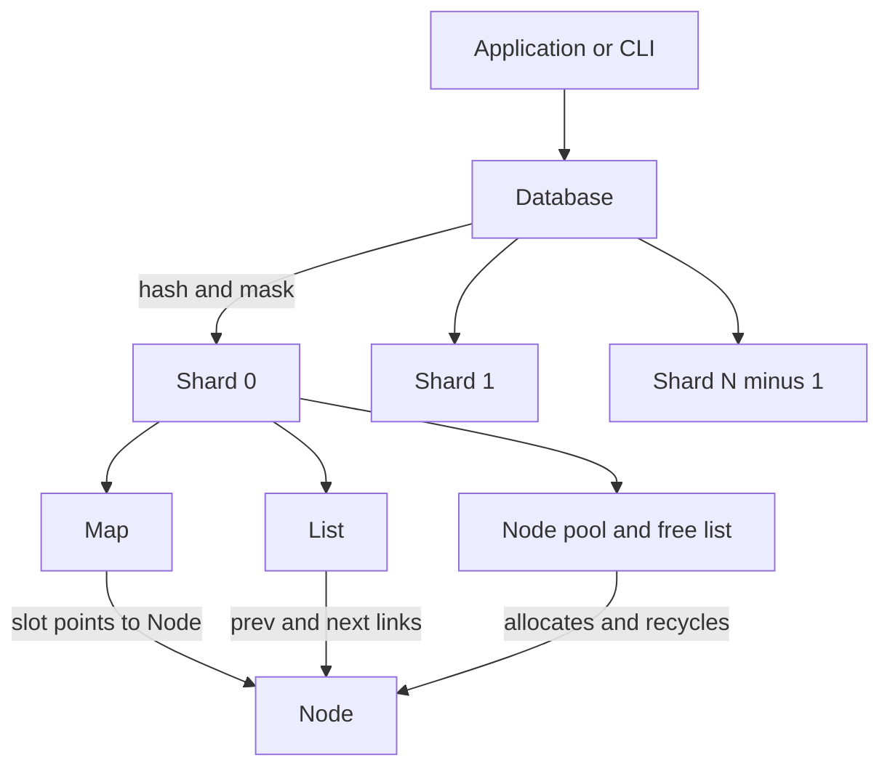

# MiniDB Architecture

MiniDB is an embedded, in-memory key-value store. It uses a sharded hash table for lookup and a per-shard LRU list for eviction. This document explains the main structures and how they work together.

## System Overview

The database receives a key. It hashes the key and selects one shard. The shard uses its map to find the node and its list to track recency.



## Data Structures

### Database

The database is the router. It holds an array of shards and a shard count.

```text
Database
  Shard **shards
  size_t num_shards
```

The shard index is `Hash(key) & (num_shards - 1)`. This requires a power-of-two shard count.

### Shard

A shard is one independent partition. It combines the hash table, the LRU list, and the node storage.

```text
Shard
  Map *map
  List *list
  size_t capacity
  size_t size
  Node *node_pool
  Node *free_list
```

`capacity` is the maximum number of live keys in the shard. `size` is the current number of live keys. The map has twice the capacity of the shard, which gives it room above the shard key limit.

### Map

The map is an open-addressed hash table. It stores one slot per bucket in a single array and uses linear probing for collisions.

```text
Map
  size_t capacity
  size_t size
  Node **table
```

A slot is a tagged `Node` pointer, so each slot is one machine word:

- `NULL`: the slot is empty.
- any other value: the slot is occupied and points to a live node.

The slot stores the pointer directly instead of a separate status field. This halves the table size and keeps the probe array cache-friendly. A delete does not leave a tombstone. Instead, `MapDelete` closes the hole with backward-shift reinsertion: it moves later entries in the probe cluster back into the freed slot when their home slot lies outside the shifted range. This keeps every probe chain valid without any cleanup pass. Because the map is sized at twice the shard capacity and the shard evicts before the map fills, the live load factor stays at or below 0.5, so the table never needs to grow or rebuild.

### List

The list is a sentinelled doubly linked list. It defines the recency order.

```text
List
  Node *head
  Node *tail
  size_t size
```

`head` and `tail` are dummy nodes. The node after `head` is the most recently used node. The node before `tail` is the least recently used node.

### Node

A node holds one key and one value inline, plus a cached copy of its key hash.

```text
Node
  char key[32]
  char value[64]
  uint32_t hash
  Node *prev_node
  Node *next_node
```

The cached `hash` is written when the node enters the map. Eviction and probe comparisons reuse it instead of recomputing the hash or running `strcmp` on every collision.

A live node has two links. The map slot points to the node, and the list links the node to its neighbors. A free node sits in the shard free list, and `next_node` becomes the free-list link.

## How the Structures Work Together

| Structure | Responsibility |
|---|---|
| Database | Hashes a key and selects a shard. |
| Shard | Owns the map, the list, and the node pool. |
| Map | Finds a key in O(1) average time. |
| List | Orders live nodes by recency. |
| Node pool | Supplies and recycles node memory. |

A live key has one node. The map slot references that node, and the list links that same node. The node pool owns the memory for every node.

A free node is not in the map and not in the list. It exists only in the free list.

## LRU Cache Implementation

The shard implements the LRU policy with the map and the list.

### Lookup

1. The map returns the node for the key.
2. The shard moves the node to the list head.
3. The shard returns the node value.

A read updates recency, so a recently read key survives longer.

### Insert

1. If the key exists, the shard updates the value and moves the node to the head.
2. If the shard is full, it unlinks the tail node from the list.
3. It deletes the tail key from the map, closing the probe cluster.
4. It pushes the tail node to the free list.
5. It pops a node from the free list.
6. It writes the new key and value into the node.
7. It inserts the node into the map and adds it to the list head.

The free-list pop and push are O(1). The node never leaves the shard pool.

### Update

The map finds the existing node. The shard writes the new value and moves the node to the list head. The map size does not change.

### Delete

The map removes the entry and shifts the rest of the probe cluster back to close the hole. The shard unlinks the node from the list and pushes it to the free list.

### Eviction

The tail of the list is the least recently used node. When a shard is full, the shard evicts that node, recycles its memory, and inserts the new key at the list head.

This makes eviction O(1). The engine does not scan for a victim.

## Hashing and Sharding

`Hash` is a 32-bit MurmurHash3 implementation. Both the shard router and the map use the low bits of the hash:

- Shard index: `hash & (num_shards - 1)`
- Map index: `hash & (map_capacity - 1)`

Both counts must be powers of two. The router does not rebalance keys. A shard can become full and evict while another shard has free space.

The database computes the hash once per operation and passes it down to the shard, which passes it to the map. The node also caches its key hash, so eviction and probe comparisons do not recompute it.

## Memory Model

Each shard allocates one block of nodes at startup. The shard links the nodes into a free list and recycles them during normal operation. The normal set, get, and delete paths do not call `malloc` or `free`.

Each shard allocates its map table once at creation. Deletes shift entries in place, so the map never allocates or frees during normal operation. The list allocates only its two sentinels.

The shard pool owns the nodes, so the list and the map never free individual nodes. On destroy, the shard frees the map, the list sentinels, the node pool, and the shard.

## Complexity

| Operation | Average | Worst case |
|---|---|---|
| Insert | O(1) | O(map capacity) |
| Lookup | O(1) | O(map capacity) |
| Delete (cluster shift) | O(1) | O(map capacity) |
| LRU update | O(1) | O(1) |
| Eviction | O(1) | O(1) |

The average case assumes a good hash distribution and a load factor at or below 0.5.

## Performance Notes

Several choices keep the hot paths small:

- The hash is computed once per operation and reused for shard selection and the map lookup.
- Each node caches its hash, so eviction and probe comparisons avoid recomputation and skip `strcmp` on most collisions.
- A map slot is one machine word, so the probe array stays within cache.
- Deletes use backward-shift reinsertion instead of tombstones, so there is no periodic table rebuild.
- Keys and values are copied with a bounded `memcpy`, not a full-buffer `strncpy`.
- A read that hits the most recently used node does not relink the list.

## Concurrency

MiniDB is single-threaded. There are no locks or atomics. A read mutates the LRU list, so the database is not safe for concurrent access without external synchronization.

The independent shard design leaves room for future lock striping. Each shard could have its own lock, but the current code does not implement that.
